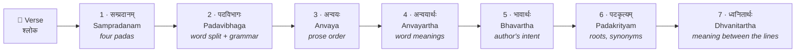
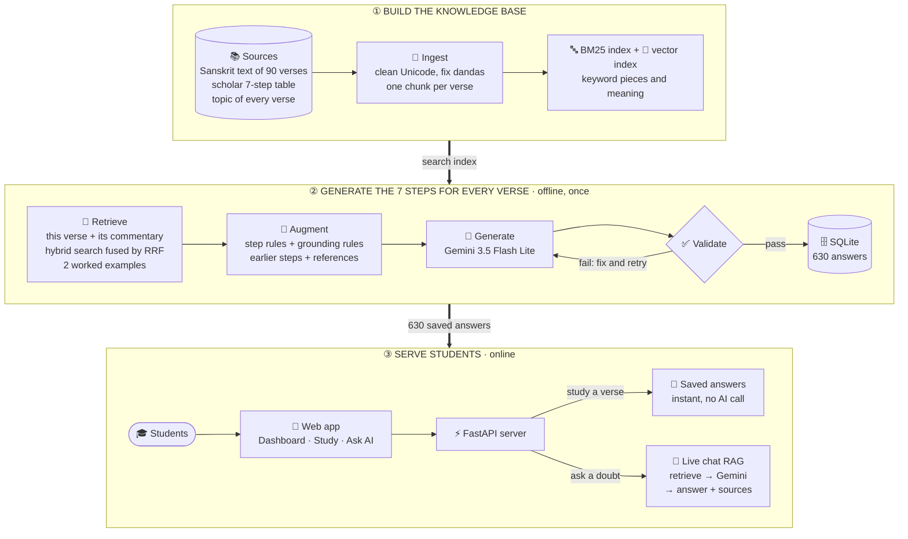
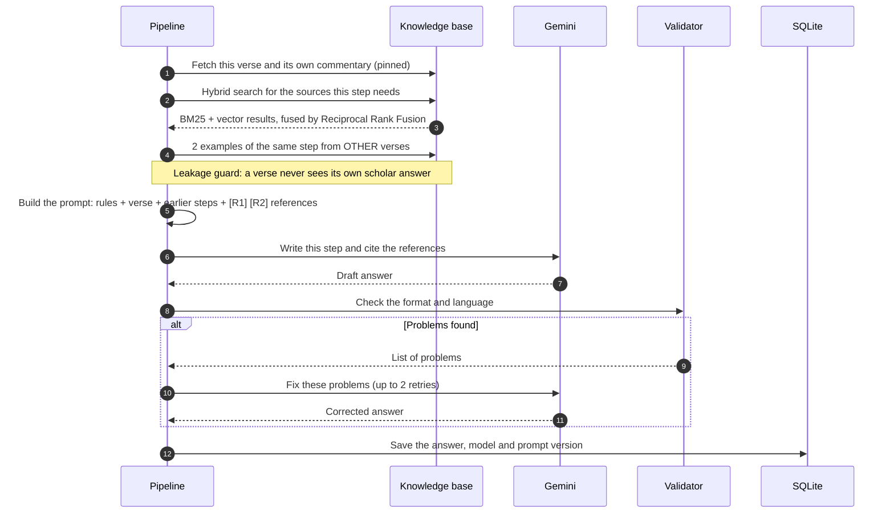
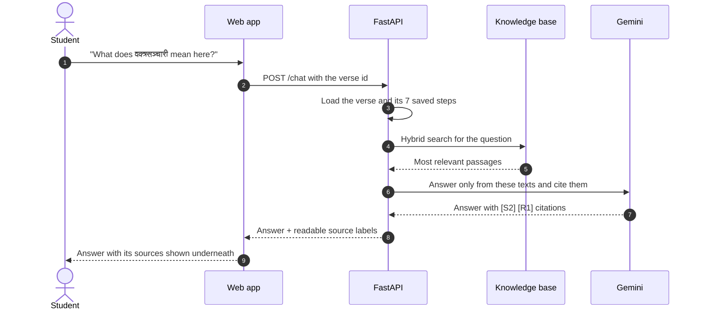

<div align="center">

# 🌿 Ayurvidya · आयुर्विद्या

### Learn classical Ayurveda verse by verse, with an AI tutor that cites its sources

*Sushruta Samhita · Nidana Sthana · Chapter 1 · Vatavyadhi Nidana*

[](https://github.com/vaishnavi-212/Ayurvidya/actions/workflows/tests.yml)


</div>

---

## 💡 The problem

Students of Ayurveda study the Samhitas in Sanskrit. Understanding a single verse properly takes seven layers of analysis: splitting the padas, separating the words, putting them in prose order, word meanings, the author's intent, the grammar and roots of every word, and the meaning between the lines. A teacher does this verse by verse in class. Outside class, students have printed commentaries that are hard to search and no one to ask.

General AI chatbots are not a safe answer: they invent quotations, mix up verses and give no sources.

## ✅ What we built

**Ayurvidya** is a Retrieval-Augmented Generation (RAG) system that:

1. Breaks the whole of Sushruta Samhita, Nidana Sthana 1 into **90 verse units** and analyses every one of them in the **7 Ayurvidya steps**: **630 answers** in total.
2. Grounds every answer in the source texts: before the AI writes anything, the system **retrieves** the right passages and the AI must **cite** them.
3. **Checks every answer automatically** and makes the AI fix any answer that breaks the format.
4. Serves everything in a **mobile web app** where students study each verse step by step, and an **Ask AI** chat that answers doubts only from the texts and shows its sources.

---

## 📖 The seven Ayurvidya steps



| Step | What the student gets | Made by |
|---|---|---|
| 1 · Sampradanam | The verse divided into its four padas | Rules (dandas + syllable count), no AI |
| 2 · Padavibhaga | Every word separated, with case, number and gender or tense | RAG + Gemini |
| 3 · Anvaya | The same words in natural prose order | RAG + Gemini |
| 4 · Anvayartha | The meaning of each word, then of the whole verse | RAG + Gemini |
| 5 · Bhavartha | What the author intends, in 2 to 5 sentences | RAG + Gemini |
| 6 · Padakrityam | For each word: root (धातु), prefix, synonyms, grammar, its role in the verse | RAG + Gemini |
| 7 · Dhvanitartha | The implied meaning, using tantrayukti and parallels in other Samhitas | RAG + Gemini |

Each step is given the answers of the steps before it, so the analysis builds up exactly as it does in class.

---

## 🏗️ How it works

The system has three parts. The knowledge base is built once, the 630 answers are generated once and saved, and students read them instantly.



### What happens when one step of one verse is generated



### What happens when a student asks a doubt



### The retrieval in detail

| Layer | What it does | Why |
|---|---|---|
| **Pinned lookup** | The verse itself and its own commentary are fetched directly by verse id | Always relevant, so they are never left to chance |
| **BM25** | Keyword search on words and 4-letter pieces, in Devanagari and Roman | Sanskrit sandhi joins words together; pieces still match |
| **Vector search** | Search by meaning | Finds related passages that use different words |
| **Reciprocal Rank Fusion** | Merges both lists: score = Σ 1 / (60 + rank) | Uses ranks, so the two very different score scales never clash |
| **Source routing** | Each step only searches the source types it needs (kosha for meanings, dhatupatha for roots, parallel texts for Dhvanitartha) | Less noise in the prompt |
| **Worked examples** | 2 scholar answers of the same step from other verses | The AI copies the expected format |
| **Leakage guard** | A verse never sees its own scholar answer | Keeps the evaluation honest |

---

## ✨ Features

| | |
|---|---|
| 📜 **Complete chapter** | All 90 verse units × 7 steps, with the topic (प्रकरण) of every verse |
| 🔗 **Grounded answers** | Every answer is built from retrieved passages and cites them |
| ✅ **Automatic checks** | Format validator per step; Bhavartha and Dhvanitartha must be in English; failed answers are retried |
| 👩‍🏫 **Scholar review** | Excel review sheet out and back in; approved answers are never overwritten |
| ⚡ **Instant app** | Saved answers load with no AI call and no API key |
| 💬 **Ask AI** | Doubt-clearing chat about the current verse, with suggested questions and sources |
| 📱 **Mobile web app** | Dashboard with progress ring and chapter map, 7-step study view, dark and light themes, installable on Android |
| 🖥️ **Terminal demo** | Shows retrieval, the prompt and the answer stage by stage |
| 📊 **Built-in evaluation** | Retrieval metrics, chrF against the scholar table, CVI, statistics, SUS |
| 🧪 **Tested** | 35 automated tests run offline on every push |

---

## 📊 Results

All 630 answers generated with **Gemini 3.5 Flash Lite**.

| Step | Passed format check | chrF vs scholar answers (verses 1–30) |
|---|:---:|:---:|
| 1 · Sampradanam | ✅ 100% | rule-based |
| 2 · Padavibhaga | ✅ 100% | **79.1** |
| 3 · Anvaya | ✅ 100% | **69.7** |
| 4 · Anvayartha | ✅ 100% | 55.6 |
| 5 · Bhavartha | ✅ 100% | 32.9 |
| 6 · Padakrityam | ✅ 100% | 28.5 |
| 7 · Dhvanitartha | ✅ 100% | 29.8 |

**How to read chrF:** it measures how many letter sequences an answer shares with the scholar's answer, from 0 to 100. Steps 2 and 3 have one correct form, so a high score means a close match. Steps 5 to 7 are free explanations: a correct answer in different words still scores low, so these steps are judged by scholar rating (CVI).

---

## 🚀 Setup

**You need:** Python 3.10 or newer and Git. An API key is **not** needed to run the app; it is only needed to generate new answers or use Ask AI.

### 1. Get the code

```bash
git clone https://github.com/vaishnavi-212/Ayurvidya.git
cd Ayurvidya
```

### 2. Create the environment and install

**Windows (PowerShell)**

```powershell
.\setup.ps1
Set-ExecutionPolicy -Scope Process -ExecutionPolicy Bypass
.\.venv\Scripts\Activate.ps1
pip install fastapi "uvicorn[standard]"
```

**macOS / Linux**

```bash
bash setup.sh
source .venv/bin/activate
pip install fastapi "uvicorn[standard]"
```

> Each time you open a new terminal, activate the environment again. The prompt then starts with `(.venv)`.

### 3. Load the verses and the saved answers

```bash
python scripts/build_kb.py
python scripts/share_answers.py import
```

### 4. Start the app

```bash
python scripts/serve.py
```

Open **http://localhost:8000/app/**. To open it on a phone, connect the phone to the same Wi-Fi and use the second address that `serve.py` prints.

### 5. (Optional) Turn on the AI for Ask AI and generation

Get a free API key at [aistudio.google.com](https://aistudio.google.com), then create a file named `.env` in the project folder:

```ini
OPENAI_API_KEY=your-gemini-key
AYV_LLM=openai:gemini-3.5-flash-lite
AYV_LLM_BASE_URL=https://generativelanguage.googleapis.com/v1beta/openai
```

Check it:

```bash
python scripts/check_llm.py
```

`.env` is ignored by Git, so the key never leaves your computer.

---

## 🖥️ See it work in the terminal

`demo.py` walks through the whole RAG pipeline for one verse, pausing between stages:

```bash
python scripts/demo.py --verse 13 --step 4
```

| Stage | What you see | Needs a key |
|---|---|:---:|
| 1 · Knowledge base | Number of chunks by type, the verse being studied | No |
| 2 · Retrieval | BM25, vector and fused rankings side by side, with timing | No |
| 3 · Augmentation | Exactly which passages and examples the AI receives, and the start of the prompt | No |
| 4 · Generation | The saved answer, its model and the format check | No |
| 5 · Live generation | The step generated again, now, with validation (`--live`) | Yes |
| 6 · Chatbot | A grounded answer with its sources (`--ask "your question"`) | Yes |

Other useful commands:

| Task | Command |
|---|---|
| Show exactly what the AI receives for any step | `python scripts/show_context.py --verse 13 --step 4` |
| Chat about a verse in the terminal | `python scripts/chat_cli.py --shloka su.ni.1.13` |
| Generate verses (resumable, paced for the free tier) | `python scripts/generate_all.py --limit 10 --pause 6` |
| Regenerate chosen steps of a verse | `python scripts/run_pipeline.py --verses 13 --steps 4 5 --force` |
| Export all 630 answers to Excel | `python scripts/run_pipeline.py --all --export outputs/su_ni_1_all_90.xlsx` |
| Quality report against the scholar table | `python scripts/quality_report.py` |
| Knowledge-base health report | `python scripts/kb_report.py` |
| Retrieval scores: BM25 vs vector vs hybrid | `python scripts/eval_retrieval.py` |
| Scholar review sheet out and back in | `python scripts/review.py export` · `python scripts/review.py import <file>` |
| Back up the answers database | `python scripts/backup_db.py` |
| Run the tests | `python -m unittest discover -s tests` |

---

## 📱 The app

| Page | What it shows |
|---|---|
| **Dashboard** | Progress ring, verses opened, steps completed, continue where you left off, verse of the day, and the chapter map in 10 sections with progress bars |
| **All verses** | Every verse as a card with its topic, filters by section, opened verses marked |
| **Study** | The verse, a 7-step tracker and each step laid out by its structure: pada lines, word tables, fold-out word cards |
| **Ask AI** | Chat about the current verse with suggested questions; each answer lists its sources |

Dark and light themes · jump to any verse by number · installable on Android from Chrome (**⋮ → Install app**).

### API

| Method | Path | Returns |
|---|---|---|
| `GET` | `/chapters/{chapter_id}/shlokas` | All verses of the chapter with their topics |
| `GET` | `/shlokas/{shloka_id}` | One verse and its 7 saved steps |
| `POST` | `/chat` | `{question, shloka_id}` → answer, citations, readable sources |
| `GET` | `/app/` | The web app |

---

## 🔁 Sharing answers between computers

The answers live in a local database (`data/ayurvidya.sqlite3`), which Git does not upload. To move them through Git:

```bash
python scripts/share_answers.py export   # on the computer that has the answers, then commit and push
python scripts/share_answers.py import   # on any other computer, after git pull
```

If both computers changed the same answer, the scholar-checked one wins, then the newer one. No API key is needed to view shared answers.

---

## 🧪 Evaluation built in

| Question | Measure | Tool |
|---|---|---|
| Does retrieval find the right passage? | Recall@k, MRR, nDCG@10 | `scripts/eval_retrieval.py` |
| Which search model is best? | The same metrics for TF-IDF, bge-m3, Qwen3 | `scripts/compare_embedders.py` |
| How close are the answers to the scholar's? | chrF per step | `scripts/quality_report.py` |
| Do scholars agree the content is valid? | I-CVI, S-CVI, modified kappa | `scripts/compute_cvi.py` |
| Does the chatbot stay faithful to its sources? | Claim-by-claim check against the retrieved text | `src/ayurvidya/evaluation/rag_judge.py` |
| Do students learn, and is the app easy to use? | Pre/post test (paired t-test or Wilcoxon), SUS | `src/ayurvidya/evaluation/stats.py` |

---

## 🧰 Tech stack

| Layer | Technology |
|---|---|
| Language | Python 3.10+ |
| Retrieval | BM25 (custom, sandhi-aware), TF-IDF character n-grams (scikit-learn), Reciprocal Rank Fusion; optional bge-m3 / Qwen3 embeddings and bge reranker |
| Generation | Gemini 3.5 Flash Lite through an OpenAI-compatible API; Anthropic and local models also supported |
| Storage | SQLite (schema ready for PostgreSQL) |
| Server | FastAPI + Uvicorn |
| App | HTML, CSS and JavaScript, installable as a PWA |
| Quality | Per-step validators, unittest suite, GitHub Actions |
| Hosting | Render |

---

## 📁 Project structure

```
Ayurvidya/
├── config/settings.yaml          settings (each can be overridden with an AYV_* variable)
├── prompts/                      the 7 step prompts, grounding rules, chatbot prompt
├── data/
│   ├── raw/                      Sanskrit text of the chapter (NIIMH)
│   ├── gold/                     scholar 7-step table, verses 1–30
│   ├── topics_su_ni_1.csv        topic of every verse
│   ├── sources/                  commentary, kosha, dhatu, parallel texts + source log
│   ├── eval/                     retrieval test questions
│   └── generated/                the 630 saved answers, shared through Git
├── src/ayurvidya/
│   ├── ingest.py · text.py       cleaning and chunking
│   ├── index.py · embed.py       BM25 and vector indexes
│   ├── retrieve.py               hybrid retrieval, RRF, per-step context
│   ├── steps.py · pipeline.py    the 7 steps, validators, orchestration
│   ├── llm.py                    AI model clients
│   ├── store.py · review.py      database, scholar review
│   ├── chatbot.py · sources.py   grounded chat, source labels
│   ├── api.py · service.py       FastAPI server
│   └── evaluation/               retrieval metrics, chrF, CVI, statistics
├── scripts/                      command-line tools
├── web/                          the mobile web app
├── tests/                        automated tests (offline)
└── render.yaml                   deployment blueprint
```

---

## 📚 Sources

- **Sanskrit text:** Sushruta Samhita, Nidana Sthana, Chapter 1, from the NIIMH e-Samhita (National Institute of Indian Medical Heritage, Hyderabad). Alternate readings are kept as पाठान्तर.
- **Scholar answers:** a validated 7-step analysis of verses 1–30, used as worked examples and as the evaluation reference.
